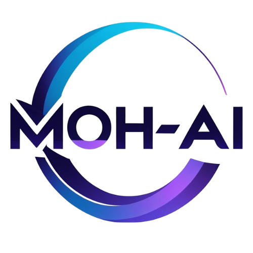

<div align="center">

  

  # Moh-AI Tech
  ### Industrial AI, Computer Vision & Practical AI Software Engineering

  [](https://nextjs.org/)
  [](https://react.dev/)
  [](https://www.typescriptlang.org/)
  [](https://pytorch.org/)
  [](https://developer.nvidia.com/tensorrt)
  [](https://udyamregistration.gov.in/)

  <p align="center">
    <strong>Building practical, deterministic AI systems from Tamil Nadu, India for businesses globally.</strong><br />
    Industrial Machine Vision · Autonomous Workflow Agents · Document Intelligence · High-Volume Tax Automation
  </p>

  <p align="center">
    <a href="https://moh-ai-tech.com">🌐 Live Production Website</a> •
    <a href="https://moh-ai-tech.com/products">📦 Product Catalog</a> •
    <a href="https://moh-ai-tech.com/taxflow">📑 Moh-AI TaxFlow Demo</a> •
    <a href="https://moh-ai-tech.com/visioninspect">🏭 VisionInspect Edge AI</a> •
    <a href="https://moh-ai-tech.com/hr-recruiter">🤖 HR Recruiter AI</a>
  </p>

</div>

---

## 📌 Executive Overview

**Moh-AI Tech** is an engineering-first artificial intelligence company based in Namakkal, Tamil Nadu, India (MSME Reg: `UDYAM-TN-14-0088280`). 

Unlike abstract generative AI wrappers, Moh-AI Tech engineers **deterministic, localized software systems** designed to solve real physical and commercial operational bottlenecks:
1. **Physical Shop-Floor Defect Inspection:** Real-time edge machine vision running on NVIDIA Jetson & industrial IPCs with sub-millimeter tolerances and PLC hardware triggers.
2. **Autonomous Domain Workflows:** High-volume financial and legal intelligence, resume screening without keyword bias, and official Meta WhatsApp Cloud API automation.

Every system is built with **strict data sovereignty, zero cloud lock-in, and air-gapped on-premise deployment options**.

---

## 🚀 The Product Portfolio Spectrum

The platform provides a complete spectrum of AI software ranging from **instant plug-and-play tools** to **heavy industrial platforms**:

```
┌─────────────────────────────────────────────────────────────────────────────┐
│                             MOH-AI TECH PRODUCT SPECTRUM                    │
├──────────────────────────┬────────────────────────────┬─────────────────────┤
│   TIER 1: PLUG & PLAY    │   TIER 2: WORKFLOW AGENTS  │   TIER 3 & 4: HEAVY │
│       MICRO-TOOLS        │        & ENTERPRISE        │     INDUSTRIAL      │
├──────────────────────────┼────────────────────────────┼─────────────────────┤
│ • WhatsApp AutoDesk      │ • Moh-AI Recruiter AI      │ • VisionInspect     │
│   (24/7 Meta API Bot)    │   (Autonomous ATS Agent)   │   (Edge Vision/PLC) │
│ • QuickInvoice OCR Lite  │ • Docu-Mind AI             │ • MachinaGuard IoT  │
│   (5-sec Tally XML/XLSX) │   (Multimodal Tables/Docs) │   (Predictive Wear) │
│ • ReviewPulse Sentinel   │ • Moh-AI TaxFlow           │ • SafeSite Vision   │
│   (Sentiment & Response) │   (CA & Statutory Audit)   │   (PPE & Intrusion) │
└──────────────────────────┴────────────────────────────┴─────────────────────┘
```

### 1. [Moh-AI TaxFlow (CA & Tax Suite)](https://moh-ai-tech.com/taxflow) `[LIVE DEMO]`
- **Flagship FinTech & Compliance Suite** built for Chartered Accountants and corporate controllers.
- **Key Modules:** 1-500 invoice batch OCR extraction, automated GSTR-2B $\leftrightarrow$ Books reconciliation, Sec 16(2)(aa) ITC at-risk recovery, Section 40A(3) cash audit flags, and 1-click WhatsApp compliance notices.
- **Interactive Experience:** Live 3-minute interactive video demo with chapter navigation pills and Tally XML integration architecture.

### 2. [VisionInspect Industrial AI](https://moh-ai-tech.com/visioninspect) `[EDGE AI]`
- **High-Speed Machine Vision System** operating at $<50\text{ ms}$ inference latency on factory conveyors.
- **Key Capabilities:** Detects hairline surface scratches ($\ge 0.08\text{ mm}$), pinhole burrs, missing assembly fasteners, and PCB solder bridges.
- **Hardware Profile:** Runs air-gapped on NVIDIA Jetson / industrial IPCs; connects to GigE Vision cameras (Basler, FLIR) and triggers 24V PLC rejection solenoids (Modbus TCP / OPC-UA).
- **Interactive Experience:** Interactive inspection scenario simulator on the product page.

### 3. [Moh-AI Recruiter AI (HireOS)](https://moh-ai-tech.com/hr-recruiter) `[AUTONOMOUS AGENT]`
- **Autonomous Talent Sourcing & Screening Agent** that replaces brittle keyword matching with deep vector semantic understanding.
- **Key Modules:** Natural language ATS command center, continuous 0-100% fit scoring, conversational pre-screening interview bots, and hiring funnel velocity analytics.
- **Interactive Experience:** Full 2:52 screencast video demo with chapter jumping and private BYOK model isolation guarantee.

### 4. [Docu-Mind AI](https://moh-ai-tech.com/documind) `[DOCUMENT INTELLIGENCE]`
- Multimodal OCR and document intelligence platform that extracts complex multi-tier nested tables, freight bills, and handwritten forms into structured JSON schemas.
- Complete self-service SaaS portal with authentication, interactive chat, dashboard, and API token management.

### 5. [Moh-AI WhatsApp AutoDesk](https://moh-ai-tech.com/whatsapp-autodesk) `[PLUG-AND-PLAY]`
- 24/7 autonomous customer support & sales order bot operating on the **Official Meta WhatsApp Business Cloud API**.
- Includes live interactive chat simulator on the page, instant product catalog lookups, and 1-click handover to human staff with zero phone number banning risk.

### 6. [QuickInvoice Free Web Utility](https://moh-ai-tech.com/tools/quickinvoice) `[FREE TOOL · VIRAL MAGNET]`
- Client-side browser tool allowing accountants and business owners to drag-and-drop any supplier invoice to extract HSN codes, GSTIN, and line-item tax splits into clean Excel and compliant Tally XML vouchers with zero cloud data retention.

### 7. [Enterprise ROI & Savings Calculator](https://moh-ai-tech.com/tools/roi-calculator) `[FINANCIAL MODELER]`
- Dual interactive calculator modeling factory conveyor scrap savings ($<50\text{ ms}$ VisionInspect) and CA firm ITC recovery & reconciliation hours automated (TaxFlow).

### 8. Regional Industrial Corridors & Solutions
- **[Coimbatore Foundry & Machining Hub](https://moh-ai-tech.com/solutions/coimbatore-pump-valve-inspection):** Optical inspection for pumps, motors, and precision machining clusters.
- **[Chennai Automotive Corridor](https://moh-ai-tech.com/solutions/chennai-auto-components):** Zero-defect machine vision for Sriperumbudur and Oragadam Tier 1/2 automotive suppliers.

---

## 🛠️ Technology Stack & Architecture

### Frontend Application
- **Framework:** Next.js 15.2.8 (React 19, App Router with Server & Client Components)
- **Languages:** TypeScript 5.0 (Strict mode enabled)
- **Styling:** Curated Vanilla CSS Design System with custom Logo Tokens (`--logo-grad`, `--logo-cyan`, `--logo-blue`, `--logo-purple`) + Tailwind CSS utilities
- **Typography:** Space Grotesk, Syne, DM Sans (Google Fonts optimized)
- **Icons & Assets:** Lucide React, optimized AVIF/WebP assets, high-definition responsive video players

### Backend & Machine Learning Services
- **Backend API:** FastAPI (Python 3.11 asynchronous microservices)
- **Computer Vision:** PyTorch, OpenCV, TensorRT, ONNX Runtime
- **OCR & Document AI:** Custom multimodal vision models, PaddleOCR, Tesseract fallback
- **Database & Vectors:** PostgreSQL 16 with `pgvector`, Prisma ORM
- **Edge Deployment:** NVIDIA Jetson Orin Nano / AGX, Linux Ubuntu Core, Docker containers

---

## 🔒 Zero-Trust Security Posture

This codebase follows exhaustive defensive programming and zero-trust security standards:

| Security Vector | Implementation Detail |
| :--- | :--- |
| **Input Sanitization** | All contact forms and user inputs pass through recursive DOMPurify and validator schemas before processing. |
| **Rate Limiting** | In-memory sliding-window rate limiters prevent API abuse and automated form spamming. |
| **HTTP Security Headers** | Strict Content-Security-Policy (CSP), `X-Content-Type-Options: nosniff`, `X-Frame-Options: SAMEORIGIN`, and HSTS enforced. |
| **Data Sovereignty** | Client candidate PII and confidential factory data are **never** retained or used for public LLM training. |
| **On-Premise Air-Gap** | VisionInspect and Industrial AI systems operate 100% offline without requiring internet connectivity on the shop floor. |
| **Secrets Isolation** | Zero hardcoded API keys or credentials; all environment values validated via strict Zod schemas at boot. |

---

## 📂 Project Structure

```
Moh-AI-Tech/
├── public/
│   ├── images/
│   │   ├── general/             # Hero dashboards, founder photo
│   │   └── products/            # Extracted video posters, product thumbnails
│   ├── videos/
│   │   ├── taxproductdemo.mp4   # 3-min interactive TaxFlow demo video
│   │   └── hr-demo.webm         # Full HireOS screencast video
│   ├── logo.png                 # Official Moh-AI Tech brand mark
│   └── llms.txt                 # AI search engine & crawler context documentation
├── src/
│   ├── app/
│   │   ├── page.tsx             # High-conversion unified Home page
│   │   ├── layout.tsx           # Global RootLayout (single Navbar, Toaster)
│   │   ├── globals.css          # Design system & official logo tokens
│   │   ├── products/            # Filterable product catalog (8 products)
│   │   ├── taxflow/             # Flagship TaxFlow suite with video player
│   │   ├── visioninspect/       # Sub-millimeter machine vision product page
│   │   ├── hr-recruiter/        # Autonomous HR Recruiter agent product page
│   │   ├── whatsapp-autodesk/   # WhatsApp customer bot with live chat simulator
│   │   ├── documind/            # Document intelligence SaaS landing & app
│   │   ├── industrial-ai/       # Industrial manufacturing intelligence pathway
│   │   ├── ai-product-engineering/ # Custom AI software engineering pathway
│   │   ├── sitemap.ts           # Dynamic XML sitemap generator (36 routes)
│   │   └── robots.ts            # Dynamic robots.txt configuration
│   ├── components/
│   │   ├── layout/navbar.tsx    # Clean floating pill navbar with active indicators
│   │   ├── layout/footer.tsx    # Comprehensive legal, company & product footer
│   │   └── i18n-provider.tsx    # Multilingual translation provider (EN, TA, DE)
│   └── lib/
│       ├── env.ts               # Environment variable validation schema
│       ├── rate-limit.ts        # Sliding window rate limiter
│       └── sanitize.ts          # Input sanitization pipeline
└── README.md                    # Repository documentation
```

---

## ⚡ Getting Started Locally

### Prerequisites
- **Node.js:** v18.18.0 or v20+ recommended
- **Package Manager:** npm (v9+) or pnpm

### 1. Clone the Repository
```bash
git clone https://github.com/MohanKumar2002/Moh-AI-Tech.git
cd Moh-AI-Tech
```

### 2. Configure Environment Variables
Copy the template configuration:
```bash
cp .env.example .env.local
```

Ensure essential keys are provided:
```env
NEXT_PUBLIC_APP_URL=http://localhost:3000
NEXTAUTH_SECRET=your-secure-32-character-secret
```

### 3. Install Dependencies
```bash
npm install
```

### 4. Run Development Server
```bash
npm run dev
```
Open [http://localhost:3000](http://localhost:3000) in your browser.

### 5. Production Build Verification
To verify type safety and static generation across all 36 routes:
```bash
npm run build
```

---

## 🌐 Deployment

The application is configured for zero-configuration continuous deployment on **Vercel** with automatic preview branches and static page caching:

- **Production Domain:** [https://moh-ai-tech.com](https://moh-ai-tech.com)
- **Edge Regions:** Global Anycast Edge Network
- **Build Command:** `next build`
- **Output:** Static HTML/JSON prerendered pages + API Route handlers

---

## 🏢 Business & Legal Information

- **Company Name:** Moh-AI Tech
- **Founder & Lead Architect:** Mohan Kumar S
- **Headquarters:** Namakkal District, Tamil Nadu, India
- **MSME Registration:** `UDYAM-TN-14-0088280`
- **Contact Inquiries:** [info@moh-ai-tech.com](mailto:info@moh-ai-tech.com)
- **WhatsApp Support:** [+91 95668 52700](https://wa.me/919566852700)
- **Founder LinkedIn:** [linkedin.com/in/mohan-kumar-subramanian](https://www.linkedin.com/in/mohan-kumar-subramanian/)

---

<div align="center">
  <small>© 2026 Moh-AI Tech. All rights reserved. Built with pride from Tamil Nadu, India.</small>
</div>
